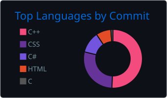
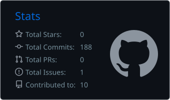
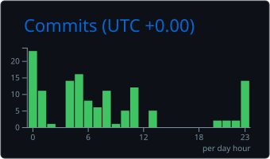
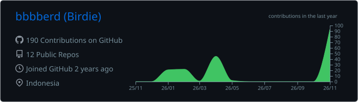

<div align="center">


</div>

# FADLI BIRDIE ZEINDA
```bash
Software Engineer | Web | Graphics | Performance goblin
```
<table>
<tr>
<td valign="top" width="52%">

```text
$ whoami
name     : Fadli Birdie Zeinda
user     : bbbberd
location : Indonesia
role     : Software Engineer
focus    : Performance
status   : online

$ ./favorite-meter --languages
c++                 ████████████████████████████████░░░░░░░░░░░░░░ 68%
rust                ████████████████████████░░░░░░░░░░░░░░░░░░░░░░ 46%
c                   ████████████████████░░░░░░░░░░░░░░░░░░░░░░░░░░ 38%
python              ███████████████████░░░░░░░░░░░░░░░░░░░░░░░░░░░ 36%
golang              ████████████░░░░░░░░░░░░░░░░░░░░░░░░░░░░░░░░░░ 22%
java                ███████████░░░░░░░░░░░░░░░░░░░░░░░░░░░░░░░░░░░ 20%
bash                ███████████░░░░░░░░░░░░░░░░░░░░░░░░░░░░░░░░░░░ 20%
sql                 ███████████░░░░░░░░░░░░░░░░░░░░░░░░░░░░░░░░░░░ 20%
typescript          ██████████░░░░░░░░░░░░░░░░░░░░░░░░░░░░░░░░░░░░ 18%
javascript          █████████░░░░░░░░░░░░░░░░░░░░░░░░░░░░░░░░░░░░░ 15%
c#                  ██████░░░░░░░░░░░░░░░░░░░░░░░░░░░░░░░░░░░░░░░░ 10%
html                ██████░░░░░░░░░░░░░░░░░░░░░░░░░░░░░░░░░░░░░░░░ 9%
css                 █████░░░░░░░░░░░░░░░░░░░░░░░░░░░░░░░░░░░░░░░░░ 7%

$ contact
email  : justbirdie00 [at] gmail [dot] com
github : github.com/bbbberd

$ spotifyctl status
last_played:
> AC/DC - War Machine
  ⣀⣀⣤⣤⣀⣀⣀⣀⣤⣤⣀⣀⣤⣀⣀⣤⣤⣀⣤⣤⣤⣀⣤⣀  [ idle ]
```
<td valign="top" width="48%">
<div align="center">
  
  
  
</div>
</td>
</tr>
</table>

---

<div align="center">
  
  
</div>
