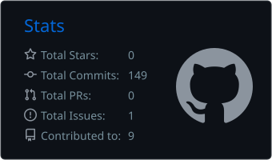
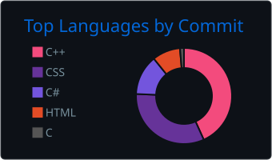

<div align="center">


</div>

```bash
$ boot profile.sh...
[ OK ] kernel loaded...
[ OK ] workspace mounted...
[ RUN ] terminal ready
```
# FADLI BIRDIE ZEINDA
```bash
Software Engineer | Web | Graphics | Performance goblin
```
<table>
<tr>
<td valign="top" width="52%">

```bash
$ whoami
name     : Fadli Birdie Zeinda
user     : bbbberd
location : Indonesia
role     : Software Engineer
focus    : Performance
status   : online

$ ./skill-meter --languages
c++                 ████████████████████████████████░░░░░░░░░░░░░░ 68%
bash                ████████████████████████░░░░░░░░░░░░░░░░░░░░░░ 46%
c#                  ████████████████████░░░░░░░░░░░░░░░░░░░░░░░░░░ 38%
java                ███████████████████░░░░░░░░░░░░░░░░░░░░░░░░░░░ 36%
javascript          ████████████░░░░░░░░░░░░░░░░░░░░░░░░░░░░░░░░░░ 22%
html                ███████████░░░░░░░░░░░░░░░░░░░░░░░░░░░░░░░░░░░ 20%
css                 ███████████░░░░░░░░░░░░░░░░░░░░░░░░░░░░░░░░░░░ 20%
c                   ███████████░░░░░░░░░░░░░░░░░░░░░░░░░░░░░░░░░░░ 20%
sql                 ██████████░░░░░░░░░░░░░░░░░░░░░░░░░░░░░░░░░░░░ 18%
php                 █████████░░░░░░░░░░░░░░░░░░░░░░░░░░░░░░░░░░░░░ 15%
typescript          ██████░░░░░░░░░░░░░░░░░░░░░░░░░░░░░░░░░░░░░░░░ 10%
golang              ██████░░░░░░░░░░░░░░░░░░░░░░░░░░░░░░░░░░░░░░░░ 9%
rust                █████░░░░░░░░░░░░░░░░░░░░░░░░░░░░░░░░░░░░░░░░░ 7%
```
</td>

<td valign="top" width="48%">

<div align="center">

<p align="center">
  
  
</p>

</div>

</td>
</tr>
</table>

---

```bash
$ ./run cube-demo
Launching render preview...
project     : cube
subjects    : 3D viewport | rendering | gltfloader
status      : keep being updated
```
<div align="center">


</div>

<div align="center">


</div>

```bash
$ spotifyctl status
now_playing:
> Linkin Park - Points of Authority

$ ps aux | grep current
running building useful software
running improving system design
running studying graphics pipelines

$ contact
email  : justbirdie00@gmail.com
github : github.com/bbbberd

$ logout
session terminated successfully.
```
